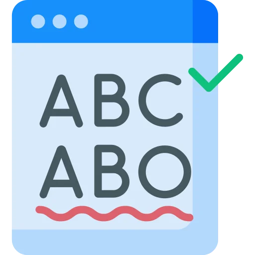
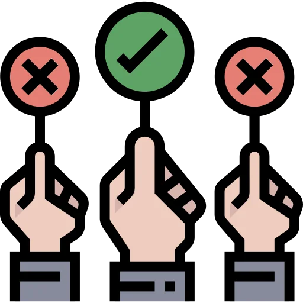
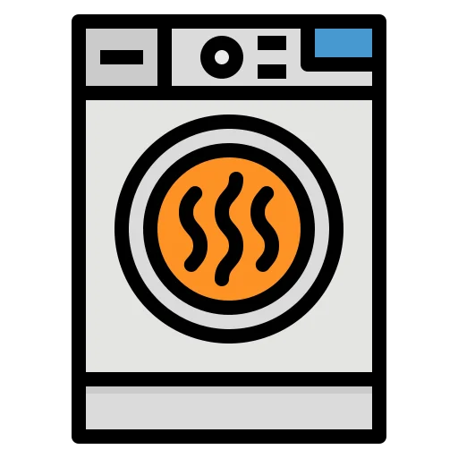
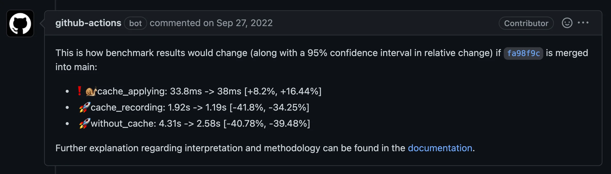
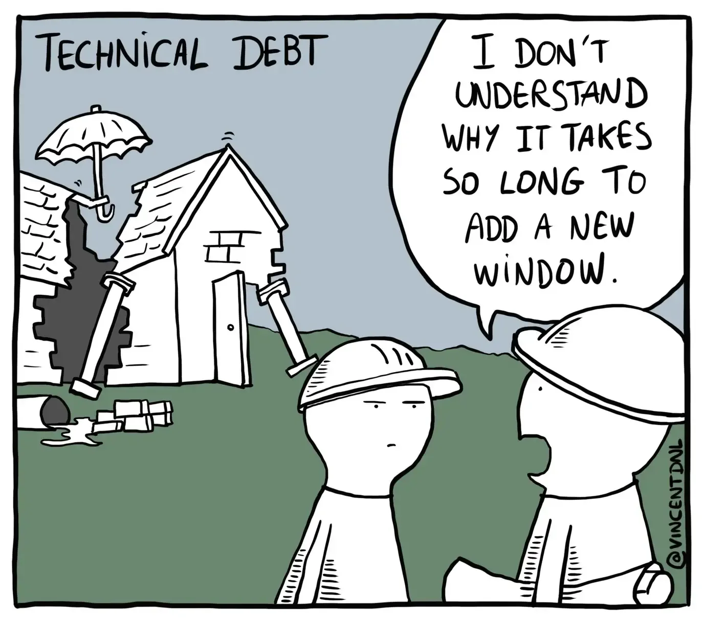
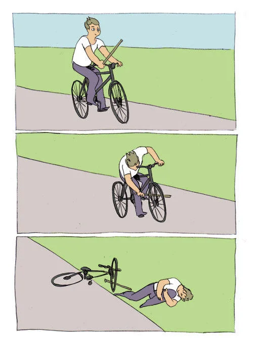

---
format:
  revealjs:
    css: style.css
    theme: simple
    revealjs-plugins:
      - a11y
      - read-aloud
    revealjs-a11y:
      # 0.2.3's menus introduce ARIA failures; retain our slide-menu handling.
      slide-menu-a11y: false
      menu: false
      # Use the extension's core accessibility fixes without extra UI/shortcuts.
      font-size-controls: false
      font-selection: false
      text-spacing: false
      transcript: false
      slide-change-cue: false
    slide-number: true
    code-line-numbers: false
    preview-links: auto
    keyboard: true
    touch: true
    help: true
    include-in-header: meta-tags.html
    include-after-body: accessibility.html
    link-external-newwindow: true
execute:
  echo: true
keywords: ["software-engineering", "r-packages", "best-practices", "CRAN"]
description-meta: "A guide to sustainable R package development through automated checks for documentation, exception handling, portability, code quality, and dependencies, plus repository instructions, skills, and prompts for terminal-based coding agents."
license: "CC0 1.0 Universal"
pagetitle: "Preventive Care for R Packages"
author-meta: "Indrajeet Patil"
date-meta: "2023-01-20"
lang: "en"
dir: "ltr"
image: "media/social-media-card.webp"
image-alt: "Preview image for presentation about preventive care for R packages"
canonical-url: "https://www.indrapatil.com/preventive-r-package-care/"
---

## Preventive Care for R Packages {.nostretch style="text-align: center;"}

::: {style="text-align: center;"}

Indrajeet Patil

:::

```{r, echo=FALSE}
#| out-height: 390px
#| fig-alt: "A watering can waters a cardboard box in a plant pot, illustrating preventive package care."

```

::: {style="text-align: center; font-size: 0.7em; margin-top: 2em; color: #666;"}
Source code for these slides can be found [on GitHub](https://github.com/IndrajeetPatil/preventive-r-package-care/){style="text-decoration: underline;"}.
:::


::: {.notes}
- Welcome the audience to this presentation on preventive care for R packages.
- Highlight the plant and watering can visual metaphor representing the proactive, ongoing cultivation required for package health.
- Note that the complete presentation source code is available on GitHub via the link in the footer.
:::

# "Software engineering ought to produce sustainability." 
\- Mark Seemann (*Code That Fits in Your Head*)


::: {.notes}
- Introduce Mark Seemann's quote from 'Code That Fits in Your Head'.
- Emphasise that software engineering is fundamentally about creating sustainable software systems that can be maintained effortlessly over time.
:::

# Target audience {.smaller}

As an R package developer, if you ever lay awake in the bed wondering:

- if the users are having a bad experience while using the package,
- if you will receive the dreaded CRAN email about archival, and
- if you will be able to update the package in time,

then this presentation is for you! 😊


::: {.notes}
- Define the target audience: R package developers who worry about user bugs, dread CRAN archival warning emails, or struggle to update packages in time.
- Reassure attendees that adopting preventive care practices resolves these persistent anxieties.
:::

# Before we begin

Don't miss the forest for the trees.


::: {.notes}
- Frame the mindset before diving into technical details: do not miss the forest for the trees.
- Remind attendees to focus on the underlying engineering principles rather than getting lost in tooling minutiae.
:::

## <span class="visually-hidden">Scope of this presentation</span> {#section .smaller}

:::{.callout-important}

## It's not about the tools

I will rely heavily on GitHub as the hosting platform and GitHub Actions as the CI/CD framework. Even if you use neither, the broader takeaways should still be relevant. You can implement the necessary checks with preferred tech stack.

:::

<br>

:::{.callout-note}

## It's not *just* about CRAN

Following the recommended practices will make packages more robust to CRAN checks, but that benefit is *incidental*. You can follow these practices even if you never plan to submit to CRAN. The goal here is to improve user experience and reduce maintenance workload.

:::

<br>

:::{.callout-tip}

## It's not even about R

The practices outlined here are just as relevant to software development in any other programming language (just replace the package with module/library/etc.).

:::


::: {.notes}
- Clarify the scope of this talk across three dimensions: it is not about the specific tools (principles apply beyond GitHub Actions), not just about CRAN (focuses on user experience and maintainability), and not solely about R (applies to software development in general).
:::

## Iconography {.smaller}

<!-- column layout -->

:::: {.columns}

::: {.column width='15%'}

```{r, echo=FALSE}
#| fig-alt: ""
#| out-extra: 'role="presentation"'

```

:::

::: {.column width='35%'}

<br>
Overarching goal

:::

::: {.column width='15%'}

```{r, echo=FALSE}
#| fig-alt: ""
#| out-extra: 'role="presentation"'

```

:::

::: {.column width='35%'}

<br>
Problem to solve

:::

::::

<!-- column layout -->

:::: {.columns}

::: {.column width='15%'}

```{r, echo=FALSE}
#| fig-alt: ""
#| out-extra: 'role="presentation"'

```

:::

::: {.column width='35%'}

<br>
Bad user experience

:::

::: {.column width='15%'}

```{r, echo=FALSE}
#| fig-alt: ""
#| out-extra: 'role="presentation"'

```

:::

::: {.column width='35%'}

<br>
Maintenance headaches

:::

::::

<!-- column layout -->

:::: {.columns}

::: {.column width='15%'}

```{r, echo=FALSE}
#| fig-alt: ""
#| out-extra: 'role="presentation"'

```

:::

::: {.column width='35%'}

<br>
Tools

:::

::: {.column width='15%'}

```{r, echo=FALSE}
#| fig-alt: ""
#| out-extra: 'role="presentation"'

```

:::

::: {.column width='35%'}

<br>
Automation

:::

::::


::: {.notes}
- Walk through the visual iconography used throughout the slides: target for overarching goals, tick mark for problems solved, confused face for poor user experiences, headache for maintenance friction, toolbox for developer tools, and robot for automated workflows.
:::

# Digging the pit of success

How can software engineering improve sustainability


::: {.notes}
- Open the section on 'Digging the pit of success'.
- Introduce the goal of designing development environments where doing the right thing is the easiest, most natural path.
:::

## Be always release-ready {.smaller}

<!-- column layout -->

:::: {.columns}

::: {.column width='70%'}

Based on research, *Accelerate* (Forsgren, Humble, & Kim, 2018) argues that the key difference between high-performing vs low-performing software teams is *the ability to make a release at the drop of a hat*.

For R packages, this translates to making sure that every commit on the `main`-branch is **release-ready**. 

That is, if you were asked to make a new release soon, you can be confident that the latest commit doesn't have any documentation issues, code quality issues, performance regressions, etc.

:::

::: {.column width='30%'}

```{r}
#| echo: false
#| out-width: "70%"
#| fig-alt: "Cover of Accelerate: The Science of Lean Software and DevOps, by Nicole Forsgren, Jez Humble, and Gene Kim."

```

:::

::::

. . . 

<br>


:::{style="background-color: #F3CCFF; padding: 20px; border-radius: 25px; text-align: center;"}

How can software engineering help to achieve this goal?

:::


::: {.notes}
- Explain the principle of always being release-ready: keeping the default branch consistently tested, documented, and stable so a release can be published at any moment without stressful preparation sprints.
:::

## Fighting software entropy {.smaller}

The biggest reason why a software project becomes unsustainable is the unchecked accumulation of complexity.

. . . 

:::: {.columns}

::: {.column width='20%'}

```{r}
#| echo: false
#| fig-alt: ""
#| out-extra: 'role="presentation"'

```

:::

::: {.column width='80%'}

**Software engineering is the active and conscious process of preventing complexity from growing.**

It provides the methodology to make sure that the software works as intended and to ensure that it stays that way.

:::

::::

. . . 

:::{style="font-size: 25px;"}

:::: {.columns}

::: {.column width='20%'}

```{r}
#| echo: false
#| fig-alt: ""
#| out-extra: 'role="presentation"'

```

:::

::: {.column width='80%'}

Software development is an inherently complex process. To make it more manageable, we break it down into checklists of best practices—each designed to stave off complexity—so that we don't forget about them.

Following each item on a checklist is a small improvement, but constantly keeping an eye on internal quality prevents software entropy from growing. Although software engineering is more than about automating this process, automation is undoubtedly an important part of it.

:::

::::

:::


::: {.notes}
- Discuss software entropy: how codebases naturally decay over time as dependencies shift, environments evolve, and unaddressed technical debt accumulates.
- Highlight automated continuous testing as the primary defence against this decay.
:::

# "The only way to go fast, is to go well."
\- Robert C. Martin


::: {.notes}
- Present Uncle Bob Martin's adage: 'The only way to go fast, is to go well.'
- Emphasise that investing in rigorous automated checks accelerates long-term development rather than slowing it down.
:::

# R package development

Using automation to tick checklists for various aspects of package development.


::: {.notes}
- Introduce the practical application of preventive care to R package development using automated checklists.
:::

## Plan

First, you will see the checklists to tick, and then the details on how to build infrastructure to ensure that none of the checklist items are forgotten.

- [Documentation](#documentation) 

- [Exception handling](#warnings)

- [Portability](#portability)

- [Code quality](#codequality)

- [Dependency management](#dependency)

- [Coding-agent readiness](#llm-readiness)


::: {.notes}
- Outline the six functional areas covered in the plan: documentation, exception handling, portability, code quality, dependency management, and coding-agent readiness.
:::

## Checklist for documentation {.smaller}

<!-- column layout -->

:::: {.columns}

::: {.column width='10%'}

```{r, echo=FALSE}
#| fig-alt: ""
#| out-extra: 'role="presentation"'

```

:::

::: {.column width='90%'}

:::{style="color: blue; text-align: center;"}

**For a good user experience, make sure that the docs are plentiful, valid, and up-to-date.**

:::

:::

::::

| Item                                                      |
| :-------------------------------------------------------- |
| Make sure there are enough examples in the documentation. |
| Make sure all README examples are working.                |
| Make sure all examples in help pages are working.         |
| Make sure examples in vignettes are working.              |
| Make sure all URLs are valid.                             |
| Make sure there are no spelling mistakes.                 |
| Make sure generated help-page HTML is valid.              |


::: {.notes}
- Review the documentation checklist: maintaining adequate example coverage, ensuring README examples work, verifying help page examples run, confirming vignette builds succeed, checking URL validity, and eliminating spelling errors.
:::

## Checklist for exception handling {.smaller}

<!-- column layout -->

:::: {.columns}

::: {.column width='10%'}

```{r, echo=FALSE}
#| fig-alt: ""
#| out-extra: 'role="presentation"'

```

:::

::: {.column width='90%'}

:::{style="color: blue; text-align: center;"}

**To reduce maintenance headaches, make sure that warnings are easily detected for further scrutiny and forthright dealt with.**

:::

:::

::::

<br>

| Item                                                     |
| :------------------------------------------------------- |
| Make sure examples in README produce no warnings.        |
| Make sure examples in help pages produce no warnings.    |
| Make sure examples in vignettes produce no warnings.     |
| Make sure tests produce no extrinsic warnings.           |


::: {.notes}
- Review the exception handling checklist: ensuring appropriate signalling via messages and warnings, avoiding swallowed warnings, suppressing intrinsic warnings, and catching upstream deprecations early.
:::

## Checklist for portability {.smaller}

<!-- column layout -->

:::: {.columns}

::: {.column width='10%'}

```{r, echo=FALSE}
#| fig-alt: ""
#| out-extra: 'role="presentation"'

```

:::

::: {.column width='90%'}

:::{style="color: blue; text-align: center;"}

**For a good user experience, make sure that package would work as expected across diverse settings.**

:::

:::

::::

<br>

| Item                                                         |
| :----------------------------------------------------------- |
| Make sure package passes checks on commonly used OS.         |
| Make sure package passes checks on all supported R versions. |
| ...                                                          |

::: {.small-note style="font-size: 0.6em;"}

The items on this list will vary significantly from package to package (e.g., does it work in different locales, with different compilers, etc.). Extend the list for your workflow!

:::


::: {.notes}
- Review the portability checklist: testing across operating systems (Linux, macOS, Windows), diverse R versions (devel, release, oldrel), compiler toolchains, and varying locales or character encodings.
:::

## Checklist for code quality {.smaller}

<!-- column layout -->

:::: {.columns}

::: {.column width='10%'}

```{r, echo=FALSE}
#| fig-alt: ""
#| out-extra: 'role="presentation"'

```

:::

::: {.column width='90%'}

:::{style="color: blue; text-align: center;"}

**To reduce maintenance headaches, make sure that the code is readable, maintainable, and follows agreed conventions.**

:::

:::

::::

<br>

| Item                                              |
| :------------------------------------------------ |
| Make sure the code follows a style guide.         |
| Make sure there are no known code quality issues. |
| Make sure there are no performance regressions.   |


::: {.notes}
- Review the code quality checklist: adhering to a consistent style guide, statically analysing code for quality issues via linters, linting non-R code, and detecting performance regressions.
:::

## Checklist for dependency management {.smaller}

<!-- column layout -->

:::: {.columns}

::: {.column width='10%'}

```{r, echo=FALSE}
#| fig-alt: ""
#| out-extra: 'role="presentation"'

```

:::

::: {.column width='90%'}

:::{style="color: blue; text-align: center;"}

**To reduce maintenance headaches, make optional features fail clearly and detect breaking dependency changes early.**

:::

:::

::::

<br>

| Item                                                                         |
| :--------------------------------------------------------------------------- |
| Guard runtime features that require a suggested dependency.                  |
| Anticipate possible breaking changes coming from dependencies and act on it. |


::: {.notes}
- Review the dependency management checklist: practicing soft dependency hygiene with Suggested packages, conditionally executing optional code paths, anticipating upstream breakages, and catching downstream impacts early.
:::

## Checklist for coding-agent readiness {.smaller}

<!-- column layout -->

:::: {.columns}

::: {.column width='10%'}

```{r, echo=FALSE}
#| fig-alt: ""
#| out-extra: 'role="presentation"'

```

:::

::: {.column width='90%'}

:::{style="color: blue; text-align: center;"}

**To get dependable help from coding agents, make sure your conventions are written down where they can be found.**

:::

:::

::::

<br>

| Item                                                      |
| :-------------------------------------------------------- |
| Make sure shared conventions are written down for agents. |
| Make sure recurring procedures and requests are reusable. |
| Make sure your documentation is machine-readable.         |


::: {.notes}
- Review the coding-agent readiness checklist: documenting shared conventions in `AGENTS.md`, modularising reusable procedures into skills, standardising recurring requests into prompt templates, and providing machine-readable documentation via `llms.txt`.
:::

# Documentation {#documentation}

Preventive care to make sure the docs are up-to-date.


::: {.notes}
- Introduce the Documentation section, focusing on preventive practices to ensure documentation stays accurate, complete, and functional.
:::

# "Incorrect documentation is often worse than no documentation."
\- Bertrand Meyer


::: {.notes}
- Highlight Bertrand Meyer's quote: 'Incorrect documentation is often worse than no documentation.'
- Note that out-of-date examples mislead users and generate unnecessary support burdens.
:::

# <span class="visually-hidden">Documentation quality</span> {#section-1}
<!-- column layout -->

:::::{style="background-color: #A9F5A9; padding: 20px; border-radius: 25px;"}

:::: {.columns}

::: {.column width='10%'}

```{r, echo=FALSE}
#| fig-alt: ""
#| out-extra: 'role="presentation"'

```

:::

::: {.column width='90%'}

:::{style="color: blue; text-align: center;"}

**For a good user experience, make sure that the docs are plentiful, valid, and up-to-date.**

:::

:::

::::

:::::


::: {.notes}
- Summarise the documentation section goals: verifying that examples exist, that all examples execute without error, and that prose is free of dead links and typos.
:::

# Make sure there are enough examples in the documentation.


::: {.notes}
- Frame the first documentation objective: ensuring that documentation contains a sufficient number of working, realistic examples.
:::

## An example is worth a thousand words {.smaller}

<!-- column layout -->

:::: {.columns}

::: {.column width='10%'}

```{r, echo=FALSE}
#| fig-alt: ""
#| out-extra: 'role="presentation"'

```

:::

::: {.column width='90%'}

Access to abundant examples in help pages and vignettes provides a natural starting point for users to explore and experiment with the available functionality. 

Good examples are difficult to write, but any examples are better than none.

:::

::::

<br>

. . .

<!-- column layout -->

:::: {.columns}

::: {.column width='10%'}

```{r, echo=FALSE}
#| fig-alt: ""
#| out-extra: 'role="presentation"'

```

:::

::: {.column width='90%'}

Without enough expository examples, users are left to fumble their way into discovering the available functionality.

:::

::::

. . .

<br>

<!-- column layout -->

:::: {.columns}

::: {.column width='10%'}

```{r, echo=FALSE}
#| fig-alt: ""
#| out-extra: 'role="presentation"'

```

:::

::: {.column width='90%'}

::: {style="color: red;"}

**How to ensure that there are *enough* number of examples?**

:::

:::

::::


::: {.notes}
- Emphasise that examples bridge the gap between abstract API contracts and concrete user problems, accelerating package adoption.
:::

## Sources of documentation {.smaller}

There are three types of documents that constitute package documentation.

<!-- column layout -->

:::: {.columns}

::: {.column width='30%'}

:::{style="text-align: center;"}

**README.md**

:::

```{r, echo=FALSE}
#| fig-alt: ""
#| out-extra: 'role="presentation"'

```

:::

::: {.column width='5%'}

:::

::: {.column width='30%'}

:::{style="text-align: center;"}

**Help pages**

:::

```{r, echo=FALSE}
#| fig-alt: ""
#| out-extra: 'role="presentation"'

```

:::

::: {.column width='5%'}

:::

::: {.column width='30%'}

:::{style="text-align: center;"}

**Vignettes**

```{r, echo=FALSE}
#| fig-alt: ""
#| out-extra: 'role="presentation"'

```

:::

:::

::::

<br>

Therefore, we want to make sure that, when combined across these sources, there are enough examples to cover a significant proportion of available functionality.


::: {.notes}
- Differentiate the three main sources of package documentation: the repository README (`README.Rmd`), function help topics (`man/*.Rd`), and long-form vignettes (`vignettes/`).
:::

## Maintaining example code coverage {.smaller}

<!-- column layout -->

:::: {.columns}

::: {.column width='9%'}

```{r, echo=FALSE}
#| fig-alt: ""
#| out-extra: 'role="presentation"'

```

:::

::: {.column width='91%'}

Use [`{covr}`](https://covr.r-lib.org/) to compute example code coverage (i.e. proportion of the source code that is executed when running examples in help pages and vignettes), and to ensure that it is above a certain threshold.

```{r, eval=FALSE}
#| code-line-numbers: false
package_coverage(type = c("examples", "vignettes"), commentDonttest = FALSE, commentDontrun = FALSE)
```

:::

::::

. . .

<!-- column layout -->

:::: {.columns}

::: {.column width='9%'}

```{r, echo=FALSE}
#| fig-alt: ""
#| out-extra: 'role="presentation"'

```

:::

::: {.column width='91%'}

Use a [GHA workflow](https://github.com/IndrajeetPatil/workflows/blob/main/.github/workflows/test-coverage.yaml) to automate checking that the code coverage via examples never drops below the chosen threshold.

:::

::::

. . .

:::{.callout-tip}

## Additional tips 

- The choice of threshold is subjective and context-sensitive. Chasing after 100% example code coverage is futile (since this would require exposing every exception in the examples).

- The examples not run or tested on CRAN can still be counted for computing code coverage.

- Vignettes not included in the package (the ones in `vignettes/` subdirectory or `.Rbuildignore`) will not contribute towards the code coverage. Ditto for `README`. You can adjust the threshold accordingly.

- You could also choose the threshold on a file basis (`covr::file_coverage()`).

:::


::: {.notes}
- Explain how to measure and track example code coverage across exported functions using `covr::package_coverage(type = "examples")` to identify undocumented functions.
:::

# Make sure all README examples are working.


::: {.notes}
- Transition to the next documentation requirement: verifying that all code snippets in the repository README execute successfully.
:::

## README documentation {.smaller}

<!-- column layout -->

:::: {.columns}

::: {.column width='10%'}

```{r, echo=FALSE}
#| fig-alt: ""
#| out-extra: 'role="presentation"'

```

:::

::: {.column width='90%'}

`README.md` provides a quick overview of the package API and can feature examples of key functions. 

Although breaking changes might be infrequent, when they do occur, the code in README may become defunct.

:::

::::

<br>

. . .

<!-- column layout -->

:::: {.columns}

::: {.column width='10%'}

```{r, echo=FALSE}
#| fig-alt: ""
#| out-extra: 'role="presentation"'

```

:::

::: {.column width='90%'}

`README.md` is probably the first and the most-visited document in a project and any broken examples therein are bound to confuse many users.

:::

::::

. . .

<br>

<!-- column layout -->

:::: {.columns}

::: {.column width='10%'}

```{r, echo=FALSE}
#| fig-alt: ""
#| out-extra: 'role="presentation"'

```

:::

::: {.column width='90%'}

::: {style="color: red;"}

**How to insure against broken code in README?**

:::

:::

::::


::: {.notes}
- Discuss the README as the front door of your package; broken code snippets in the README create an immediate negative first impression for new users.
:::

## Detecting broken README examples {.smaller}

<!-- column layout -->

:::: {.columns}

::: {.column width='10%'}

```{r, echo=FALSE}
#| fig-alt: ""
#| out-extra: 'role="presentation"'

```

:::

::: {.column width='90%'}

Use [`devtools::build_readme()`](https://devtools.r-lib.org/reference/build_rmd.html) to render `README.qmd` or `README.Rmd` in a clean R session against a temporary installation of the package. Broken code will make the render fail.

```{r, eval=FALSE}
#| code-line-numbers: false
devtools::build_readme()
```

:::

::::

<br>

. . .

<!-- column layout -->

:::: {.columns}

::: {.column width='10%'}

```{r, echo=FALSE}
#| fig-alt: ""
#| out-extra: 'role="presentation"'

```

:::

::: {.column width='90%'}

Use a [GHA workflow](https://github.com/IndrajeetPatil/workflows/blob/main/.github/workflows/check-extra.yaml) to automate checking that README can be successfully rendered on each commit.

:::

::::

. . .

:::{.callout-tip}

## Additional tips 

- If you are starting a new project, create README using [`usethis::use_readme_rmd()`](https://usethis.r-lib.org/reference/use_readme_rmd.html).

:::


::: {.notes}
- Detail how to automate README validation in CI: knitting `README.Rmd` into `README.md` via `devtools::build_readme()` on pull requests to catch syntax and API regressions.
:::

# Make sure *all* examples in help pages are working.


::: {.notes}
- Transition to the requirement of ensuring that all examples in function help pages run without error.
:::

## Broken examples in help pages {.smaller}

<!-- column layout -->

:::: {.columns}

::: {.column width='10%'}

<br>

```{r, echo=FALSE}
#| fig-alt: ""
#| out-extra: 'role="presentation"'

```

:::

::: {.column width='90%'}

:::{.callout-note}

## Types of examples

Help pages for exported functions should contain examples illustrating their usage. But you can skip executing some examples (e.g. because they are too time-consuming) using any of the following tags:

|      Tag      | `example()` | `R CMD check` | `R CMD check --as-cran` |
| :-----------: | :---------: | :-----------: | :---------------------: |
| `\dontrun{}`  |     ❌      |      ❌       |           ❌            |
| `\donttest{}` |     ✅      |      ❌       |           ✅            |
| `\dontshow{}` |     ✅      |      ✅       |           ✅            |

:::

:::

::::

. . . 

<!-- column layout -->

:::: {.columns}

::: {.column width='10%'}

```{r, echo=FALSE}
#| fig-alt: ""
#| out-extra: 'role="presentation"'

```

:::

::: {.column width='90%'}

Thus, broken `\dontrun{}` examples are never flagged by `R CMD check`. Users will still see these examples and wonder why they aren't working.

:::{style="font-size: 20px;"}

Since [R 4.0.0](https://stat.ethz.ch/pipermail/r-announce/2020/000653.html), `R CMD check --as-cran` runs `\donttest{}` examples automatically.

:::

:::

::::

. . . 

<!-- column layout -->

:::: {.columns}

::: {.column width='10%'}

```{r, echo=FALSE}
#| fig-alt: ""
#| out-extra: 'role="presentation"'

```


:::

::: {.column width='90%'}

::: {style="color: red;"}

**How to catch examples that don't run successfully?**

:::

:::

::::


::: {.notes}
- Explain how help page examples break over time due to changed function signatures, altered return values, or unmaintained `\dontrun{}` blocks.
:::

## Checking all examples {.smaller}

<!-- column layout -->

:::: {.columns}

::: {.column width='10%'}

```{r, echo=FALSE}
#| fig-alt: ""
#| out-extra: 'role="presentation"'

```

:::

::: {.column width='90%'}

Use [`{devtools}`](https://r-lib.github.io/devtools/) to run all examples, and catch and fix the broken ones.

```{r, eval=FALSE}
#| code-line-numbers: false
devtools::run_examples(run_dontrun = TRUE, run_donttest = TRUE)
```

:::

::::

. . .

<!-- column layout -->

:::: {.columns}

::: {.column width='10%'}

```{r, echo=FALSE}
#| fig-alt: ""
#| out-extra: 'role="presentation"'

```

:::

::: {.column width='90%'}

Use a [GHA workflow](https://github.com/IndrajeetPatil/workflows/blob/main/.github/workflows/check-extra.yaml) to make sure all examples in help pages are working on each commit.

:::

::::

. . .

:::{.callout-tip}

## Additional tips 

- Examples that are *meant* to fail should use any of the following patterns:

    * `if (FALSE) { ... }` (if example is included only for illustrative purposes)
    * `try({ ... })` (if the intent is to display the error message)

:::


::: {.notes}
- Show how to test all roxygen `@examples` blocks across the package using `devtools::run_examples()` in automated CI workflows.
:::

# Make sure examples in *all* vignettes are working.


::: {.notes}
- Transition to the next documentation check: verifying that all vignette articles compile and evaluate cleanly.
:::

## Vignette examples {.smaller}

<!-- column layout -->

:::: {.columns}

::: {.column width='10%'}

<br>

```{r, echo=FALSE}
#| fig-alt: ""
#| out-extra: 'role="presentation"'

```

:::

::: {.column width='90%'}

:::{.callout-note}

## Vignettes and pkgdown articles

Use a **vignette** for long-form documentation that ships with the package and is checked by `R CMD check`. Use an **article** for pkgdown-only documentation that is not shipped.

`R CMD check` does not run code in pkgdown-only articles.

:::

:::

::::

<br>

. . . 

<!-- column layout -->

:::: {.columns}

::: {.column width='10%'}

```{r, echo=FALSE}
#| fig-alt: ""
#| out-extra: 'role="presentation"'

```

:::

::: {.column width='90%'}

Broken examples in pkgdown-only articles still harm users. Keeping them executable also prevents surprises if an article later becomes a shipped vignette.

:::

::::

. . . 

<!-- column layout -->

:::: {.columns}

::: {.column width='10%'}

```{r, echo=FALSE}
#| fig-alt: ""
#| out-extra: 'role="presentation"'

```


:::

::: {.column width='90%'}

::: {style="color: red;"}

**How do you check pkgdown-only articles?**

:::

:::

::::


::: {.notes}
- Discuss vignettes as in-depth tutorials; because they execute extended workflows, they are particularly vulnerable to breaking changes in upstream dependencies.
:::

## Building all articles {.smaller}

<!-- column layout -->

:::: {.columns}

::: {.column width='10%'}

```{r, echo=FALSE}
#| fig-alt: ""
#| out-extra: 'role="presentation"'

```

:::

::: {.column width='90%'}

Although pkgdown-only articles may not be checked by `R CMD check`, they are still built by [`{pkgdown}`](https://r-lib.github.io/pkgdown/) to generate a static website. Thus, building a website would detect broken examples in those articles.

```{r, eval=FALSE}
#| code-line-numbers: false
pkgdown::build_site()
```

:::

::::

<br>

. . .

<!-- column layout -->

:::: {.columns}

::: {.column width='10%'}

```{r, echo=FALSE}
#| fig-alt: ""
#| out-extra: 'role="presentation"'

```

:::

::: {.column width='90%'}

Use a [GHA workflow](https://github.com/r-lib/actions/blob/v2-branch/examples/pkgdown.yaml) to make sure examples in *all* pkgdown articles are working on each commit.

:::

::::

. . .

:::{.callout-tip}

## Additional tips 

- Code chunks that are *meant* to fail should use `error=TRUE` option.

:::


::: {.notes}
- Detail the automation for building all package vignettes and articles using `devtools::build_vignettes()` or `pkgdown::build_articles()` during continuous integration.
:::

# Make sure *all* URLs are valid.


::: {.notes}
- Transition to link validation: making sure that all hyperlinks across package documentation remain active and reachable.
:::

## What is link rot? {.smaller}

<!-- column layout -->

:::: {.columns}

::: {.column width='10%'}

<br>

<span class="deck-icon deck-icon-2xl deck-icon-solid-link-slash" role="img" aria-label="link slash"></span>

:::

::: {.column width='90%'}

Package documentation often includes plenty of hyperlinks to external resources. But some of them may become invalid over time.

[Link rot](https://en.wikipedia.org/wiki/Link_rot) happens because web pages move to new addresses or become permanently unavailable.

:::

:::: 

. . . 

<br>

<!-- column layout -->

:::: {.columns}

::: {.column width='10%'}

```{r, echo=FALSE}
#| fig-alt: ""
#| out-extra: 'role="presentation"'

```

:::

::: {.column width='90%'}

Such dangling references can be frustrating for the users trying to access the resources that the dead links were previously pointing to.

:::

::::

. . . 

<br>

<!-- column layout -->

:::: {.columns}

::: {.column width='10%'}

```{r, echo=FALSE}
#| fig-alt: ""
#| out-extra: 'role="presentation"'

```


:::

::: {.column width='90%'}

::: {style="color: red;"}

**How to prevent link rot from accumulating in the documentation?**

:::

:::

::::


::: {.notes}
- Define link rot: external documentation, repository URLs, CRAN links, and academic citations decaying into broken 404 or 500 errors over time.
:::

## Detecting link rot {.smaller}

<!-- column layout -->

:::: {.columns}

::: {.column width='10%'}

```{r, echo=FALSE}
#| fig-alt: ""
#| out-extra: 'role="presentation"'

```

:::

::: {.column width='90%'}

You can use [`{urlchecker}`](https://r-lib.github.io/urlchecker/) to detect dead web references and their locations in the documentation. Fixing these links is then straightforward.

```{r, eval=FALSE}
#| code-line-numbers: false
urlchecker::url_check()
```

:::

::::

<br>

. . .

<!-- column layout -->

:::: {.columns}

::: {.column width='10%'}

```{r, echo=FALSE}
#| fig-alt: ""
#| out-extra: 'role="presentation"'

```

:::

::: {.column width='90%'}

Use [GHA workflow](https://github.com/IndrajeetPatil/workflows/blob/main/.github/workflows/check-link-rot.yaml) to check for bad URLs on each commit.

:::

::::

. . .

:::{.callout-tip}

## Additional tips 

- If `{urlchecker}` finds dead URLs in `.html`/`.md` files, you will need to update `.Rmd`/`.qmd` files and then regenerate the docs. Otherwise, you will keep wondering why `urlchecker::url_update()` isn't fixing the links.

- There can be false positives sometimes because a server is temporarily down. Re-triggering the workflow can help. If false positives persist, you may decide to not mark builds as failed if any broken links are found.

:::


::: {.notes}
- Demonstrate automated link rot detection using dedicated tools such as `lychee` or `urlchecker::url_check()` in scheduled weekly CI jobs.
:::

# Make sure there are no spelling mistakes.


::: {.notes}
- Transition to spelling hygiene: eliminating spelling mistakes and typographic errors from user-facing documentation.
:::

## Spelling mistakes {.smaller}

<!-- column layout -->

:::: {.columns}

::: {.column width='10%'}

```{r, echo=FALSE}
#| fig-alt: ""
#| out-extra: 'role="presentation"'

```

:::

::: {.column width='90%'}

Spelling mistakes are inevitable and, if left unchecked, they can accumulate rapidly with the increase in the documentation.

:::

::::

. . .

<!-- column layout -->

:::: {.columns}

::: {.column width='10%'}

<br>

```{r, echo=FALSE}
#| fig-alt: ""
#| out-extra: 'role="presentation"'

```

:::

::: {.column width='90%'}

Spelling mistakes obvious to native speakers may not be so for non-native speakers, who will be frustrated that they can't find the meaning of the misspelt word. 

Additionally, misspelling technical words (e.g. *innode* vs. [*inode*](https://en.wikipedia.org/wiki/Inode)) can lead users down the wrong path and waste their time. 

:::

::::

. . .

<br>

<!-- column layout -->

:::: {.columns}

::: {.column width='10%'}

```{r, echo=FALSE}
#| fig-alt: ""
#| out-extra: 'role="presentation"'

```

:::

::: {.column width='90%'}

::: {style="color: red;"}

**How to prevent spelling mistakes from accumulating in the documentation?**

:::

:::

::::


::: {.notes}
- Discuss why typos in documentation and error messages degrade professionalism and impair searchability for functions and arguments.
:::

## Creating a list of allowed misspellings {.smaller}

<!-- column layout -->

:::: {.columns}

::: {.column width='68%'}

There exist multiple English spelling standards (e.g. in British English: *anaemia*, but in American English: *anemia*). You can specify your preferred standard in `DESCRIPTION`.

:::

::: {.column width='30%'}

E.g. for British English

```dcf
Language: en-GB
```

:::

::::

. . . 

<br>

<!-- column layout -->

:::: {.columns}

::: {.column width='58%'}

Additionally, some technical words will not be recognised by dictionaries, but you don't want these to be considered spelling mistakes either. You can create a list of allowed misspelt words in the `WORDLIST` file.

:::

::: {.column width='20%'}

File location

```
├── DESCRIPTION
├── inst
│   └── WORDLIST
```

:::

::: {.column width='20%'}

Example file

```
addin
api
AppVeyor
biocthis
bootswatch
...
winbuilder
YAML
```

:::

::::

. . . 

:::{.callout-tip}

## Updating the word list

Run `spelling::update_wordlist()` after reviewing spelling results. It adds accepted technical terms to `inst/WORDLIST` and removes entries that are no longer needed.

:::


::: {.notes}
- Explain how to maintain a project-specific whitelist of allowed domain terms, acronyms, and package names in `inst/WORDLIST` using `spelling::update_wordlist()`.
:::

## Detecting spelling mistakes {.smaller}

<!-- column layout -->

:::: {.columns}

::: {.column width='10%'}

```{r, echo=FALSE}
#| fig-alt: ""
#| out-extra: 'role="presentation"'

```

:::

::: {.column width='90%'}

Use [`{spelling}`](https://docs.ropensci.org/spelling/) to detect misspelt words and their location in the docs.

```{r, eval=FALSE}
#| code-line-numbers: false
spelling::spell_check_package()
```

:::

::::

. . .

<!-- column layout -->

:::: {.columns}

::: {.column width='10%'}

```{r, echo=FALSE}
#| fig-alt: ""
#| out-extra: 'role="presentation"'

```

:::

::: {.column width='90%'}

Use [GHA workflow](https://github.com/IndrajeetPatil/workflows/blob/main/.github/workflows/check-extra.yaml) to ensure that spelling mistakes are caught on each commit.

:::

::::

. . .

:::{.callout-tip}

## Additional tips 

- Instead of a GHA workflow, you can also include spell check tests in the package itself. For more, see `usethis::use_spell_check()`.

- [`R CMD check --as-cran`](https://stat.ethz.ch/CRAN/doc/manuals/r-devel/R-exts.html#Checking-packages) validates generated HTML5 help pages when a recent HTML Tidy is available. The [r-lib workflow](https://github.com/r-lib/actions/blob/v2-branch/examples/html-5-check.yaml) installs that prerequisite explicitly.

:::


::: {.notes}
- Show how to automate spell checking in CI by invoking `spelling::spell_check_package()` to gate pull requests on clean prose.
:::

# Exception handling {#warnings}

Preventive care to make sure that you don't miss out on important warnings.


::: {.notes}
- Introduce the Exception Handling and Warnings section, focusing on clear communication and avoiding hidden diagnostic issues.
:::

# "There is a problem with warnings. No one reads them." 
\- Patrick Burns


::: {.notes}
- Quote Patrick Burns: 'There is a problem with warnings. No one reads them.'
- Note that unaddressed warnings easily accumulate into noise that obscures critical operational failures.
:::

# <span class="visually-hidden">Detecting warnings</span> {#section-2 aria-label="Detecting warnings: overview"}
<!-- column layout -->

:::::{style="background-color: #A9F5A9; padding: 20px; border-radius: 25px;"}

:::: {.columns}

::: {.column width='10%'}

```{r, echo=FALSE}
#| fig-alt: ""
#| out-extra: 'role="presentation"'

```

:::

::: {.column width='90%'}

:::{style="color: blue; text-align: center;"}

**To reduce maintenance headaches, make sure that warnings are easily detected for further scrutiny and forthright dealt with.**

:::

:::

::::

:::::


::: {.notes}
- Summarise the section objectives: sending appropriate diagnostic signals, suppressing benign internal noise, and resolving external deprecation warnings promptly.
:::

## Sending signals {.smaller}

<!-- column layout -->

:::: {.columns}

::: {.column width='10%'}

<br>

```{r, echo=FALSE}
#| fig-alt: ""
#| out-extra: 'role="presentation"'

```

:::

::: {.column width='90%'}

:::{.callout-note}

## Types of conditions/exceptions

A function can use [conditions](https://adv-r.hadley.nz/conditions.html) to signal that something unexpected has happened with varying severity.

| Condition | Severity |                         Meaning                          |
| :-------: | :------: | :------------------------------------------------------: |
|  `error`  |   high   |  execution stopped because there was no way to continue  |
| `warning` |  medium  |     execution encountered some problem but recovered     |
| `message` |   low    | execution was successful and here are some extra details |

:::

:::

::::

Out of these, warnings are the most nebulous! 

- Errors bring functions to a halt and you *must* attend to them. 
- Messages are non-fatal diagnostics; they usually need no action, but can still carry useful information.
- But warnings are harbingers of problems that you will need to fix at some point. They *need* to be dealt with, *pronto*, and yet it is easy to ignore them.


::: {.notes}
- Contrast R's three signalling mechanisms: `message()` for purely informational updates, `warning()` for potential problems that do not halt execution, and `stop()` for unrecoverable errors.
:::

## A needle in the haystack {.smaller}

:::{.callout-note}

## Types of warnings

There are two kinds of warnings that you, as a developer, will need to deal with:

:::: {.columns}

::: {.column width='45%'}

**Intrinsic warnings** are warnings produced by functions in *your* package.

E.g. a warning from a function to winsorize data.

```{r}
#| eval: false
#| code-line-numbers: false
winsorize(x, threshold = 2)
#> Warning message:
#> `threshold` for winsorization must be a scalar between 0 and 0.5.
```

:::

::: {.column width='55%'}

**Extrinsic warnings** are warnings stemming from your package *dependencies*.

E.g. a possible [warning](https://github.com/jtlandis/ggside/issues/39) if your package relies on `{ggside}`.

```{r}
#| eval: false
#| code-line-numbers: false
ggplot(mpg, aes(hwy, class)) + geom_xsidedensity()
#> Warning: Using the `size` aesthetic in this geom was deprecated in ggplot2 3.4.0.
#> ℹ Please use `linewidth` in the `default_aes` field and elsewhere instead.
```

:::

::::

:::

. . . 

<!-- column layout -->

:::: {.columns}

::: {.column width='10%'}

<br>

```{r, echo=FALSE}
#| fig-alt: ""
#| out-extra: 'role="presentation"'

```

:::

::: {.column width='90%'}

With a significant amount of package functionality and dependencies, there can be plenty of warnings at any given moment.

To avoid missing out on important warnings, there should ideally be **zero of either type of warnings** in your package documentation and tests. This makes it easy to notice and deal with new, potentially critical warnings as they appear.

:::

::::


::: {.notes}
- Illustrate the 'needle in the haystack' dilemma: when build logs are flooded with repeated warnings, critical notices and deprecations are easily overlooked.
:::

## Suppressing intrinsic warnings {.smaller}

There is almost never a need to explicitly highlight warnings intrinsic to your package.

. . .

::: {style="background-color: #FFDCA9; padding: 20px; border-radius: 25px;"}

- Warnings are generated in contexts where functions in *your* package were used unexpectedly by the users. But such contexts shouldn't be deliberately highlighted in the documentation. Users should always see [happy path](https://en.wikipedia.org/wiki/Happy_path) examples in help pages, README, or vignettes.

- While testing functions, you should use expectations (e.g. `testthat::expect_warning()`) to check that expected warnings are triggered. You shouldn't print the warnings, since they can completely overwhelm the test log and make it difficult to catch important warnings.

:::


::: {.notes}
- Explain how to address intrinsic warnings generated by your own code: refactor the implementation so that benign conditions are handled cleanly without issuing warnings.
:::

## Suppressing extrinsic warnings {.smaller}

Warnings from dependencies can be critical and should be dealt with ASAP.

. . .

::: {style="background-color: #FFFBC1; padding: 20px; border-radius: 25px;"}

- If dependencies are emitting warnings because your functions are using imported code in unexpected ways, rewrite functions to remove warnings.

- If the warnings are about deprecated functions or arguments, switch to using the suggested alternatives. Don't wait until they are removed.

- Suppress a warning only after you understand it and cannot avoid it. When the dependency signals a classed warning, [base R can suppress only that class](https://www.stat.ethz.ch/R-manual/R-devel/library/base/html/warning.html): `suppressWarnings(expr, classes = "known_warning_class")`.

- Report upstream warnings to the maintainer and remove temporary suppression once the issue is fixed. Avoid blanket suppression in user-facing examples.

:::


::: {.notes}
- Discuss extrinsic warnings arising from third-party dependencies: update usage promptly to conform to new APIs rather than simply suppressing the warning.
:::

## Detecting warnings {.smaller}

<!-- column layout -->

:::: {.columns}

::: {.column width='10%'}

```{r, echo=FALSE}
#| fig-alt: ""
#| out-extra: 'role="presentation"'

```

:::

::: {.column width='90%'}

Make unexpected warnings fail the relevant check. Use `warn = 2L` for executable documentation and testthat's native `stop_on_warning` argument for tests.

```{r, eval=FALSE}
#| code-line-numbers: false
options(warn = 2L)
testthat::test_local(stop_on_warning = TRUE)
```

:::

::::

. . .

<!-- column layout -->

:::: {.columns}

::: {.column width='10%'}

```{r, echo=FALSE}
#| fig-alt: ""
#| out-extra: 'role="presentation"'

```

:::

::: {.column width='90%'}

Use GHA workflows to automate warning checks in [help pages](https://github.com/IndrajeetPatil/workflows/blob/main/.github/workflows/test-coverage.yaml), [README, vignettes, and tests](https://github.com/IndrajeetPatil/workflows/blob/main/.github/workflows/check-extra.yaml) on each commit.

:::

::::

. . .

:::{.callout-tip}

## Additional tips 

- If a function is *designed* to show warnings, then you can prevent workflows from failing by conditionally running it.

:::: {.columns}

::: {.column width='50%'}

```{r}
#| eval: false
#| code-line-numbers: false
#' @examplesIf getOption("warn") < 2L
#' function_showing_warning()
```

:::

::: {.column width='50%'}

````{verbatim, eval=FALSE}
#| code-line-numbers: false
```{r eval = getOption("warn") < 2L}
function_showing_warning()
```

````

:::

::::

- While you are at, it might also be worth cleaning up intrinsic and extrinsic messages. They might be harmless, but they do clog up logs and make it difficult to focus on warnings.

- Setting `warning=FALSE` in vignettes only suppresses warnings in the rendered output. When users run this code interactively, they will still see warnings. [Ostrich policy](https://en.wikipedia.org/wiki/Ostrich_policy) never works for software development.

:::


::: {.notes}
- Show how to detect warnings strictly in test suites and CI by elevating warnings to errors with `options(warn = 2)` and setting strict R check environment variables.
:::

# Portability {#portability}

Preventive care to make sure that your package works across a variety of settings.


::: {.notes}
- Introduce the Portability section, focusing on verifying package compatibility across varied computing environments.
:::

# "Each new user of a new system uncovers a new class of bugs."
\- Brian Kernighan


::: {.notes}
- Quote Brian Kernighan: 'Each new user of a new system uncovers a new class of bugs.'
- Emphasise that diversity of environments is an asset for unearthing edge-case bugs.
:::

# <span class="visually-hidden">Portability</span> {#section-3 aria-label="Portability: overview"}
<!-- column layout -->

:::::{style="background-color: #A9F5A9; padding: 20px; border-radius: 25px;"}

:::: {.columns}

::: {.column width='10%'}

```{r, echo=FALSE}
#| fig-alt: ""
#| out-extra: 'role="presentation"'

```

:::

::: {.column width='90%'}

:::{style="color: blue; text-align: center;"}

**For a good user experience, make sure that package works as expected across diverse settings.**

:::

:::

::::

:::::


::: {.notes}
- Summarise portability goals: testing across operating systems, R versions, compilers, and locales to guarantee consistent behaviour.
:::

## The unbearable diversity of contexts {.smaller}

<!-- column layout -->

:::: {.columns}

::: {.column width='10%'}

```{r, echo=FALSE}
#| fig-alt: ""
#| out-extra: 'role="presentation"'

```

:::

::: {.column width='90%'}

You (the developer) may be developing the package in a certain setting: with a certain version of R, on a particular OS, in a certain locale, etc. Even if all tests pass and all examples run successfully for you locally, you can't assume that your users will use the package in similar settings. 

:::

::::

. . .

<!-- column layout -->

:::: {.columns}

::: {.column width='10%'}

```{r, echo=FALSE}
#| fig-alt: ""
#| out-extra: 'role="presentation"'

```

:::

::: {.column width='90%'}

If you restrict checks to your own setup, you may miss problems experienced by users elsewhere (e.g. graphics code can behave differently across operating systems, or code can fail on the oldest R version you claim to support).

:::{style="font-size: 20px;"}

The key assumption here is that your package claims to support these settings. If your package docs clearly state that the package will work only on (e.g.) Windows, you don't need to worry about other OS.

:::

:::

::::

<br>

. . .

<!-- column layout -->

:::: {.columns}

::: {.column width='10%'}

```{r, echo=FALSE}
#| fig-alt: ""
#| out-extra: 'role="presentation"'

```

:::

::: {.column width='90%'}

::: {style="color: red;"}

**How to make sure that your package is working as expected across various settings?**

:::

:::

::::


::: {.notes}
- Detail the diversity of contexts: operating systems (Linux, macOS, Windows), R release cycles (devel, release, oldrel), compiler flags, and non-UTF-8 locale encodings.
:::

## Checking across multiple settings {.smaller}

<!-- column layout -->

:::: {.columns}

::: {.column width='10%'}

```{r, echo=FALSE}
#| fig-alt: ""
#| out-extra: 'role="presentation"'

```

:::

::: {.column width='90%'}

Use [`{rcmdcheck}`](https://r-lib.github.io/rcmdcheck/) to run `R CMD check` from R.

```{r, eval=FALSE}
#| code-line-numbers: false
rcmdcheck::rcmdcheck()
```

:::{style="font-size: 20px;"}

All the options you can set to further customize this check is beyond the scope of the current presentation.

:::

:::

::::

. . .

<!-- column layout -->

:::: {.columns}

::: {.column width='10%'}

```{r, echo=FALSE}
#| fig-alt: ""
#| out-extra: 'role="presentation"'

```

:::

::: {.column width='90%'}

Use [GHA workflow](https://github.com/IndrajeetPatil/workflows/blob/main/.github/workflows/R-CMD-check.yaml) to run `R CMD check` for multiple R versions and platforms on each commit to probe for potential portability issues.

:::

::::

. . .

:::{.callout-tip}

## Additional tips 

- If needed, you can run checks on additional platforms using [`{rhub}`](https://r-hub.github.io/rhub/articles/rhub.html).

- Fully crossed checks (all major platforms $\times$ all supported R versions) are rarely necessary and definitely an overkill.

- Test the oldest R version declared in `DESCRIPTION`. If your checks only cover newer versions, raise the stated minimum instead of claiming support you do not verify.

:::


::: {.notes}
- Explain how to test across multiple platforms using GitHub Actions matrix builds and R-hub services (`rhub` or `r-hub/actions`) before submitting to CRAN.
:::

# Code quality {#codequality}

Preventive care to detect code quality issues and performance regressions.


::: {.notes}
- Introduce the Code Quality section, covering automated styling, static code analysis, and performance benchmarking.
:::

# "Don’t comment bad code—rewrite it."
\- Brian W. Kernighan


::: {.notes}
- Quote Kernighan and Plauger: 'Don’t comment bad code—rewrite it.'
- Stress that clean, expressive code is superior to code burdened with explanatory comments.
:::

# <span class="visually-hidden">Code maintainability</span> {#section-4}
<!-- column layout -->

:::::{style="background-color: #A9F5A9; padding: 20px; border-radius: 25px;"}

:::: {.columns}

::: {.column width='10%'}

```{r, echo=FALSE}
#| fig-alt: ""
#| out-extra: 'role="presentation"'

```

:::

::: {.column width='90%'}

:::{style="color: blue; text-align: center;"}

**To reduce maintenance headaches, make sure that the code is readable, maintainable, and follows agreed conventions.**

:::

:::

::::

:::::


::: {.notes}
- Summarise code quality goals: enforcing style guidelines, catching static lints, and preventing unnoticed performance regressions.
:::

# Make sure the code follows a style guide.


::: {.notes}
- Transition to automated code style enforcement and formatting consistency.
:::

## Code formatting {.smaller}

<!-- column layout -->

:::: {.columns}

::: {.column width='10%'}

<br>

```{r, echo=FALSE}
#| fig-alt: ""
#| out-extra: 'role="presentation"'

```

:::

::: {.column width='90%'}

The physical layout of the program can assist the reader in understanding the underlying logic. Additionally, understanding a large codebase is easier when all the code has consistent formatting. Style guides outline conventions to enforce a uniform formatting schema across the codebase. 

:::{style="font-size: 20px;"}

Style guides can be highly opinionated and arbitrary. So, more important than *which* style guide you follow is the fact that you follow *a* style guide.

:::

:::

::::

. . .

<!-- column layout -->

:::: {.columns}

::: {.column width='10%'}

```{r, echo=FALSE}
#| fig-alt: ""
#| out-extra: 'role="presentation"'

```

:::

::: {.column width='90%'}

In larger projects or teams, multiple contributors may have different formatting preferences. This can lead to contributors undoing each others' changes, leading to unnecessarily large git diffs and even unnecessary unpleasantness.

:::

::::

. . .

<!-- column layout -->

<br>

:::: {.columns}

::: {.column width='10%'}

```{r, echo=FALSE}
#| fig-alt: ""
#| out-extra: 'role="presentation"'

```

:::

::: {.column width='90%'}

::: {style="color: red;"}

**How to make sure that codebase follows a consistent style guide?**

:::

:::

::::


::: {.notes}
- Discuss the value of consistent code formatting: eliminating subjective style debates and keeping version control diffs clean and readable.
:::

## Following style guide {.smaller}

<!-- column layout -->

:::: {.columns}

::: {.column width='10%'}

```{r, echo=FALSE}
#| fig-alt: ""
#| out-extra: 'role="presentation"'

```

:::

::: {.column width='90%'}

Use [`air`](https://github.com/posit-dev/air) to format R code consistently throughout the package (including source code, test files, vignettes, etc.). `air` is a fast, opinionated R code formatter inspired by tools like Prettier (JS) and Black (Python).

```{bash, eval=FALSE}
#| code-line-numbers: false
air format .
```

:::

::::

. . .

<!-- column layout -->

:::: {.columns}

::: {.column width='10%'}

```{r, echo=FALSE}
#| fig-alt: ""
#| out-extra: 'role="presentation"'

```

:::

::: {.column width='90%'}

Use [GHA workflow](https://github.com/IndrajeetPatil/workflows/blob/main/.github/workflows/check-formatting.yaml) to check that code is consistently formatted on each commit.

:::

::::

. . .

:::{.callout-tip}

## Additional tips 

- Run [`usethis::use_air()`](https://usethis.r-lib.org/reference/use_air.html) to create a project-level `air.toml`, so collaborators and CI use the same formatting configuration.

- Format locally with `air format .`; in CI, use `air format . --check` so the job reports drift without rewriting the branch.

:::


::: {.notes}
- Show how to automate code formatting using `styler::style_pkg()` and pre-commit hooks to strictly follow the tidyverse style guide.
:::

# Make sure there are no known code quality issues.


::: {.notes}
- Transition to static code analysis and identifying known code smells.
:::

## Code quality assessment {.smaller}

<!-- column layout -->

:::: {.columns}

::: {.column width='10%'}

```{r, echo=FALSE}
#| fig-alt: ""
#| out-extra: 'role="presentation"'

```

:::

::: {.column width='90%'}

[Code smells](https://en.wikipedia.org/wiki/Code_smell) (aka lints) are patterns that are known to be problematic for readability, efficiency, consistency, style, etc. Catching such issues early on can help prevent bugs and other issues from creeping into code, which can save time and effort when it comes to debugging and testing.

:::: {.columns}

::: {.column width='40%'}

```{r}
#| echo: false
library(lintr)
```


```{r}
#| eval: true
#| code-line-numbers: false
# code with a lint
lint(text = "x = 1")
```

:::

::: {.column width='10%'}

:::

::: {.column width='40%'}

```{r}
#| eval: true
#| code-line-numbers: false
# code without a lint
lint(text = "x <- 1")
```

:::

::::


:::

::::

. . .

<!-- column layout -->

:::: {.columns}

::: {.column width='10%'}

```{r, echo=FALSE}
#| fig-alt: ""
#| out-extra: 'role="presentation"'

```

:::

::: {.column width='90%'}

In larger projects or teams, where multiple contributors may be working on the same codebase, it can become difficult for an individual contributor to detect code quality issues that they or someone else may have introduced.

:::

::::

. . .

<!-- column layout -->

:::: {.columns}

::: {.column width='10%'}

```{r, echo=FALSE}
#| fig-alt: ""
#| out-extra: 'role="presentation"'

```

:::

::: {.column width='90%'}

::: {style="color: red;"}

**How to make sure that there are no known code quality issues present?**

:::

:::

::::


::: {.notes}
- Discuss code quality assessment: using static analysers to catch undefined globals, unused variables, overly complex logic, and obsolete functions.
:::

## Detecting lints {.smaller}

<!-- column layout -->

:::: {.columns}

::: {.column width='10%'}

```{r, echo=FALSE}
#| fig-alt: ""
#| out-extra: 'role="presentation"'

```

:::

::: {.column width='90%'}

Use [`{lintr}`](https://r-lib.github.io/lintr/dev/) to carry out static code analysis to detect code quality issues.

```{r, eval=FALSE}
#| code-line-numbers: false
lintr::lint_package()
```

:::

::::

. . .

<!-- column layout -->

:::: {.columns}

::: {.column width='10%'}

```{r, echo=FALSE}
#| fig-alt: ""
#| out-extra: 'role="presentation"'

```

:::

::: {.column width='90%'}

Use [GHA workflow](https://github.com/IndrajeetPatil/workflows/blob/main/.github/workflows/lint.yaml) to detect all lints on each commit.

:::{style="font-size: 20px;"}

:::: {.columns}

::: {.column width='60%'}

This workflow can be overwhelming at first as it can detect thousands of lints. It includes two parallel jobs: a full-package lint (runs on every push and PR) and a `lint-changed-files` job (runs only on PRs).

The `lint-changed-files` job fails if lints are found **only** in files that changed in a Pull Request. This is an easier and less disheartening way to clean lints.

:::

::: {.column width='40%'}

```yaml
# `lint` job (push & PRs)
env:
  LINTR_ERROR_ON_LINT: true
```

<br>

```yaml
# `lint-changed-files` job (PRs only)
env:
  LINTR_ERROR_ON_LINT: true
```

:::

::::

:::

:::

::::

. . .

:::{.callout-tip}

## Additional tips 

- Most lints related to code formatting can be removed using [`air`](https://github.com/posit-dev/air).

- Code smells are subjective and you may disagree with some linters. Use a [configuration file](https://lintr.r-lib.org/dev/articles/lintr.html) to customize which linters you wish to include. Additionally, you can annotate parts of code that linters should ignore (e.g. `# nolint start: indentation_linter.` + `# nolint end`).

:::


::: {.notes}
- Explain how to configure `lintr::lint_package()` and project `.lintr` configuration files to run static lint checks on every pull request.
:::

## Detecting issues with non-R code {.smaller}

<!-- column layout -->

:::: {.columns}

::: {.column width='10%'}

```{r, echo=FALSE}
#| fig-alt: ""
#| out-extra: 'role="presentation"'

```

:::

::: {.column width='90%'}

An R package contains a number of configuration files written in languages other than R (e.g., YAML, JSON, DCF, etc.), and you may also wish to make sure that none of them are malformed.

:::

::::

. . .

<br>

<!-- column layout -->

:::: {.columns}

::: {.column width='10%'}

```{r, echo=FALSE}
#| fig-alt: ""
#| out-extra: 'role="presentation"'

```

:::

::: {.column width='90%'}

To detect multi-language code issues, you can use [prek](https://github.com/j178/prek) — a fast, Rust-native drop-in replacement for [pre-commit](https://pre-commit.com/) — to manage and maintain git hooks. The [`{precommit}`](https://lorenzwalthert.github.io/precommit/) R package provides R-specific hooks.

:::{style="font-size: 20px;"}

The framework offers [hundreds of hooks](https://pre-commit.com/hooks.html) to choose from and you can choose ones relevant to your config files (e.g. to lint and format JSON and YAML files).

:::

:::

::::

. . .

<br>

<!-- column layout -->

:::: {.columns}

::: {.column width='10%'}

```{r, echo=FALSE}
#| fig-alt: ""
#| out-extra: 'role="presentation"'

```

:::

::: {.column width='90%'}

Use [GHA workflow](https://github.com/IndrajeetPatil/workflows/blob/main/.github/workflows/pre-commit.yaml) to detect any problems with non-R code on each commit. You can specify the hooks relevant to you in a [prek config file](https://github.com/IndrajeetPatil/statsExpressions/blob/main/.pre-commit-config.yaml).

:::

::::


::: {.notes}
- Address linting compiled and non-R code: checking C++, C, JavaScript, or Markdown files using tools like `cpplint` or markdown linters when packages include foreign code.
:::

# Make sure there are no performance regressions.


::: {.notes}
- Transition to tracking computational performance and memory consumption.
:::

## Don't slow it down {.smaller}

<!-- column layout -->

:::: {.columns}

::: {.column width='10%'}

```{r, echo=FALSE}
#| fig-alt: ""
#| out-extra: 'role="presentation"'

```

:::

::: {.column width='90%'}

If your package is mature and stable enough that you have started to invest in improving its efficiency, it is important that you have some metric by which you can benchmark if a new Pull Request improves or degrades performance in comparison with the latest commit on `main`.

:::

::::

. . .

<!-- column layout -->

:::: {.columns}

::: {.column width='10%'}

```{r, echo=FALSE}
#| fig-alt: ""
#| out-extra: 'role="presentation"'

```

:::

::: {.column width='90%'}

Checking for performance regressions just before or even after the release is not ideal, since it might be difficult to revert back to the state before regression took place.

:::

::::

. . .

<br>

<!-- column layout -->

:::: {.columns}

::: {.column width='10%'}

```{r, echo=FALSE}
#| fig-alt: ""
#| out-extra: 'role="presentation"'

```

:::

::: {.column width='90%'}

::: {style="color: red;"}

**How to reliably benchmark Pull Requests for performance regressions?**

:::

:::

::::


::: {.notes}
- Discuss performance regressions: how well-intentioned refactoring can inadvertently introduce algorithmic bottlenecks or excessive allocations.
:::

## Detecting performance regressions {.smaller}

<!-- column layout -->

:::: {.columns}

::: {.column width='10%'}

```{r, echo=FALSE}
#| fig-alt: ""
#| out-extra: 'role="presentation"'

```

:::

::: {.column width='90%'}

[`{touchstone}`](https://lorenzwalthert.github.io/touchstone/) offers a continuous benchmarking tool for reliable relative measurement of performance in the Pull Request versus `main`-branch. The results are directly reported as a comment in GitHub Pull Requests.

```{r}
#| echo: false
#| eval: true
#| fig-alt: "Touchstone benchmark report: cache applying slows from 33.8 to 38 milliseconds, while cache recording improves from 1.92 to 1.19 seconds and running without cache improves from 4.31 to 2.58 seconds."

```


:::

::::

. . .

<!-- column layout -->

:::: {.columns}

::: {.column width='10%'}

```{r, echo=FALSE}
#| fig-alt: ""
#| out-extra: 'role="presentation"'

```

:::

::: {.column width='90%'}

Use [GHA workflow](https://github.com/r-lib/styler/blob/main/.github/workflows/touchstone-comment.yaml) for benchmarking PRs and detecting any performance regressions.

:::

::::


::: {.notes}
- Demonstrate how to detect performance regressions across commits using microbenchmarking tools like `{bench}` or continuous benchmarking frameworks like `{touchstone}`.
:::

# Dependency management {#dependency}

Preventive care for optional features and upstream changes.


::: {.notes}
- Introduce the Dependency Management section, focusing on minimising external risk, loose coupling, and graceful degradation.
:::

# "Dependencies are invitations for other people to break your package."
\- Joshua Ulrich


::: {.notes}
- Quote the reality of software dependencies: 'Dependencies are invitations for other people to break your package.'
- Remind attendees to weigh the cost and reliability of every added dependency.
:::

# <span class="visually-hidden">Dependency management</span> {#section-5 aria-label="Dependency management: overview"}
<!-- column layout -->

:::::{style="background-color: #A9F5A9; padding: 20px; border-radius: 25px;"}

:::: {.columns}

::: {.column width='10%'}

```{r, echo=FALSE}
#| fig-alt: ""
#| out-extra: 'role="presentation"'

```

:::

::: {.column width='90%'}

:::{style="color: blue; text-align: center;"}

**To reduce maintenance headaches, make optional features fail clearly and detect breaking dependency changes early.**

:::

:::

::::

:::::


::: {.notes}
- Summarise dependency management goals: maintaining strict hygiene for Suggested packages, conditional feature execution, and early detection of upstream breakages.
:::

## Types of Dependencies {.smaller}

<!-- column layout -->

:::: {.columns}

::: {.column width='10%'}

```{r, echo=FALSE}
#| fig-alt: ""
#| out-extra: 'role="presentation"'

```

:::

::: {.column width='90%'}

Dependencies (code that your source code relies on) are an inevitable part of package development.

:::

::::

. . . 

:::{.callout-note}

## Not all dependencies are created equal! 

Hard dependencies have a broader scope because they are needed at runtime; i.e. your package won't work without them, while soft dependencies have a narrow scope; e.g. because they are needed only for testing or for examples.

| Dependency |  In `DESCRIPTION`   |                        Scope                        |
| :--------: | :-----------------: | :-------------------------------------------------: |
|    Hard    | `Depends`/`Imports` |    Needed for your package to work as expected.     |
|    Soft    |     `Suggests`      | Optional features, examples, tests, or vignettes.   |

:::

:::{.callout-important}

## Dependencies bring risk

If a critical dependency becomes unavailable (e.g. because its author decides to archive it), bad luck. You **must** either refactor to remove dependency or look for an alternative. Otherwise, your package is no longer going to work. But this shouldn't be the case for soft dependencies since they are not critical for your package to work.

:::


::: {.notes}
- Clarify the distinctions between hard dependencies (`Depends`, `Imports`), soft dependencies (`Suggests`, `Enhances`), and their respective runtime implications.
:::

# Use suggested dependencies deliberately.


::: {.notes}
- Transition to the disciplined handling of optional packages declared under `Suggests`.
:::

## Soft dependency hygiene {.smaller}

<!-- column layout -->

:::: {.columns}

::: {.column width='10%'}

```{r, echo=FALSE}
#| fig-alt: ""
#| out-extra: 'role="presentation"'

```

:::

::: {.column width='90%'}

Users do not necessarily install packages in `Suggests`. Any runtime feature that needs one must check for it and provide either a clear error or a fallback.

:::

::::

. . .

<!-- column layout -->

:::: {.columns}

::: {.column width='10%'}

```{r, echo=FALSE}
#| fig-alt: ""
#| out-extra: 'role="presentation"'

```

:::

::: {.column width='90%'}

Package-development contexts are different: [current R package guidance](https://r-pkgs.org/dependencies-in-practice.html#sec-dependencies-in-practice-suggests) assumes `Suggests` are installed before running examples, vignettes, and tests. Guarding every use adds noise and can silently reduce test coverage.

:::{style="font-size: 20px;"}

Use conditional execution there only for genuine environmental constraints, such as authentication, network access, OS support, or an unusually difficult installation.

:::

:::

::::

. . .

<br>

<!-- column layout -->

:::: {.columns}

::: {.column width='10%'}

```{r, echo=FALSE}
#| fig-alt: ""
#| out-extra: 'role="presentation"'

```

:::

::: {.column width='90%'}

::: {style="color: red;"}

**Where does a suggested dependency actually need a guard?**

:::

:::

::::


::: {.notes}
- Emphasise soft dependency hygiene: never calling `library()` or unconditional namespace operators on Suggested packages within shipped package functions.
:::

## Conditional dependency usage {.smaller}

:::: {.columns}

::: {.column width='50%'}

**In package code:** guard a feature that a user can reach without installing the suggested package.

```r
if (!requireNamespace("lme4", quietly = TRUE)) {
  stop("Install 'lme4' to use this feature.")
}

lme4::lmer(...)
```

:::

::: {.column width='50%'}

**In development code:** assume declared `Suggests` are installed unless the prerequisite is genuinely exceptional.

```{.r}
#' @examplesIf can_authenticate()
#' query_remote_service()

testthat::skip_if_offline()
```

:::

::::

::: {style="text-align: center; font-size: 0.55em; margin-top: 1em;"}
Sources: [R Packages (2e): suggested dependencies](https://r-pkgs.org/dependencies-in-practice.html#sec-dependencies-in-practice-suggests) and [`testthat` skipping guidance](https://testthat.r-lib.org/reference/skip.html).
:::


::: {.notes}
- Demonstrate safe conditional usage using `rlang::is_installed()` or `requireNamespace(..., quietly = TRUE)` with informative fallback errors via `cli::cli_abort()`.
:::

## Anticipating breakages {.smaller}

<!-- column layout -->

:::: {.columns}

::: {.column width='10%'}

```{r, echo=FALSE}
#| fig-alt: ""
#| out-extra: 'role="presentation"'

```

:::

::: {.column width='90%'}

Check dependency changes before they reach your users. Upstream maintainers may warn reverse dependencies about breaking changes, but that communication cannot be assumed.

:::{style="font-size: 20px;"}

Packages outside CRAN, and tests skipped on CRAN, may never appear in upstream reverse-dependency checks.

:::

:::

::::

. . .

<!-- column layout -->

:::: {.columns}

::: {.column width='10%'}

```{r, echo=FALSE}
#| fig-alt: ""
#| out-extra: 'role="presentation"'

```

:::

::: {.column width='90%'}

You may figure out that something is broken *after* a dependency is updated, the package stops working for the users, and they inform you. This is especially true if your package is not under active development, and so CI/CD won't detect that your package is broken.

:::

::::

. . .

<br>

<!-- column layout -->

:::: {.columns}

::: {.column width='10%'}

```{r, echo=FALSE}
#| fig-alt: ""
#| out-extra: 'role="presentation"'

```

:::

::: {.column width='90%'}

::: {style="color: red;"}

**How to detect upcoming breaking changes in dependencies?**

:::

:::

::::


::: {.notes}
- Explain reverse dependency checking using `revdepcheck::revdep_check()` to anticipate whether proposed changes will break downstream packages on CRAN.
:::

## Detecting breakages early {.smaller}

<!-- column layout -->

:::: {.columns}

::: {.column width='10%'}

```{r, echo=FALSE}
#| fig-alt: ""
#| out-extra: 'role="presentation"'

```

:::

::: {.column width='90%'}

In order to detect breakages earlier, you can run `R CMD check` by installing development versions of dependencies. 

:::

::::

. . .

<!-- column layout -->

:::: {.columns}

::: {.column width='10%'}

```{r, echo=FALSE}
#| fig-alt: ""
#| out-extra: 'role="presentation"'

```

:::

::: {.column width='90%'}

Use scheduled GHA workflow to automate checking breakages (e.g. checking against R-devel or GitHub versions of dependencies).

:::{style="font-size: 20px;"}

How frequently you should run this check (e.g., once a month, once every six months, etc.) and which dependencies you should include (e.g., only hard, only soft, a few of each, etc.) depends on how actively both your own package and your dependencies are being developed. 

:::

:::

::::

. . .

<br>

:::{.callout-tip}

## What should you do if you *do* detect a breakage?

- If the root cause of breakage turns out to be a regression in the dependency, discuss with the maintainer.

- If the breakage is legitimate, make a PR to your repo with a fix but merge only when either the maintainer informs you of an upcoming release or the package has a new release. **Don't** push the fix to the `main`-branch because the breaking change could be reverted before release.

:::


::: {.notes}
- Detail how to detect breakages early by running scheduled CI builds against the development versions of upstream dependencies.
:::

# Eco-friendly workflows

Do you *really* need to run all workflows on each commit?!


::: {.notes}
- Introduce the Eco-Friendly Workflows section, discussing continuous integration efficiency and resource conservation.
:::

## Skipping workflows {.smaller}

:::: {.columns}

::: {.column width='70%'}

GitHub-hosted workflows consume time and compute. Not every check needs the same trigger or cadence, especially for minor documentation-only changes.

:::

::: {.column width='30%'}

:::{style="font-size: 20px;"}

Example of an insignificant change.

:::

```diff
# In `NEWS.md`
- witdh
+ width
```

:::

::::

. . . 

:::{.callout-tip}

## Reducing count of workflow runs

You can use a few or all of the following options to reduce the frequency with which the workflows are run.

- Run workflows only when a PR is marked "Ready for Review".
- Run slower checks such as spelling and link rot on weekly or monthly schedules once their baseline is green.
- Run some workflows only when ready for a new release.
- Cancel [workflows in progress](https://docs.github.com/en/actions/using-jobs/using-concurrency) if a new commit is made.
- Keep required branch-protection checks running on every relevant PR update; skipped required checks can remain pending and block merging.

:::


::: {.notes}
- Show how to skip unnecessary CI workflow runs for markdown or documentation edits using path filtering (`paths-ignore`) or commit message tags (`[skip ci]`).
:::

# Caveats

No good practice is dogma. There always exist exceptions.


::: {.notes}
- Open the Caveats section: balancing automated discipline with practical development flexibility.
:::

## Using workflows flexibly {.smaller}

- You can skip some workflows or create new workflows depending on the project-specific demands (e.g. compiled code, database connections, API access, etc.).

- Sometimes it might not even be possible to run all workflows successfully because a few of them conflict with each other. Choose required checks and scheduling based on the risks of the package.


::: {.notes}
- Explain how to adapt automated workflows to package maturity and scope, acknowledging that not every small utility requires the full suite of checks.
:::

# Failure is the only option

It is necessary that builds fail for any existing or newly found issues.


::: {.notes}
- Introduce the principle that failure is the only option: CI must fail loudly and decisively whenever checks detect issues.
:::

# "Later equals never."
\- LeBlanc's Law


::: {.notes}
- Quote LeBlanc's Law: 'Later equals never.'
- Emphasise that deferring fixes for broken checks or failing tests inevitably leads to unmanageable technical debt.
:::

## Managing technical debt {.smaller}

:::: {.columns}

::: {.column width='40%'}

<!-- [Credits](https://vincentdnl.com/drawings/) -->

```{r}
#| echo: false
#| fig-cap-location: bottom
#| fig-alt: "Technical debt cartoon: a collapsing house is propped up while a manager asks why adding a window takes so long."

```

:::

::: {.column width='60%'}

:::{.callout-tip}

## Tomorrow never comes

It might seem excessive that workflows fail if *any* issue is found (*"Really?! You want builds to fail even if there is a single code quality issue?!"*).

But this is the only way to sidestep procrastination (*"We can fix the broken link later!"*) that can lead to the accumulation of technical debt. With time, this debt can compound and every new feature requires longer to implement.

Failed builds also act as organisational quality control mechanisms. You will no longer need to justify carving out time to address technical debt if a new release can't be made unless all checks are green.

:::

:::

::::

:::{.callout-note}

## Once green, always green

The initial work you will put into achieving green checks will pay dividends in the long run. And, once a check is green, you only need to make sure that it stays that way for each new commit to the `main`-branch.

:::


::: {.notes}
- Discuss strategies for managing technical debt: treating accumulated warnings and lints with urgency before they compound.
:::

## Easing into it {.smaller}

:::: {.columns}

::: {.column width='40%'}

```{r}
#| echo: false
#| out-width: "100%"
#| fig-alt: "A cyclist puts a stick into the front wheel and falls off the bicycle."

```

:::

::: {.column width='60%'}

It might not be feasible to implement all workflows in one go, especially when they will be marked as failed until *all* relevant issues have been dealt with.

This is especially true for organisations that have a policy to always keep the default branch "green".

:::{style="font-size: 20px;"}

I'd highly recommend that you adopt such a policy, both for your organisation and private repositories.

:::

:::{style="background-color: #FFD56F; padding: 20px; border-radius: 25px;"}

You can adopt an **incremental approach** of adding one workflow per PR.

This PR can be merged when the new workflow runs successfully.

:::

:::

::::


::: {.notes}
- Provide practical advice for easing into preventive care: adopt checks iteratively rather than attempting to fix all historical lint and coverage debt in a single stroke.
:::

# Coding-agent readiness {#llm-readiness}

Preventive care to make sure that coding agents can find your conventions.


::: {.notes}
- Introduce the Coding-Agent Readiness section, covering best practices for making repositories understandable and maintainable by AI coding assistants.
:::

# "The hottest new programming language is English."
\- Andrej Karpathy


::: {.notes}
- Quote Andrej Karpathy: 'The hottest new programming language is English.'
- Frame prompt instructions and structured documentation as the new programming layer.
:::

# <span class="visually-hidden">Coding-agent readiness</span> {#section-6 aria-label="Coding-agent readiness: overview"}
<!-- column layout -->

:::::{style="background-color: #A9F5A9; padding: 20px; border-radius: 25px;"}

:::: {.columns}

::: {.column width='10%'}

```{r, echo=FALSE}
#| fig-alt: ""
#| out-extra: 'role="presentation"'

```

:::

::: {.column width='90%'}

:::{style="color: blue; text-align: center;"}

**To get dependable help from coding agents, make sure your conventions are written down where they can be found.**

:::

:::

::::

:::::


::: {.notes}
- Summarise coding-agent readiness goals: establishing explicit conventions, modularising tasks, and structuring machine-readable documentation.
:::

## Making conventions explicit {.smaller}

<!-- column layout -->

:::: {.columns}

::: {.column width='10%'}

```{r, echo=FALSE}
#| fig-alt: ""
#| out-extra: 'role="presentation"'

```

:::

::: {.column width='90%'}

You know which files are generated, which checks to run, and which changes could break downstream packages. A coding agent needs to find this information too.

:::

::::

. . .

<!-- column layout -->

:::: {.columns}

::: {.column width='10%'}

```{r, echo=FALSE}
#| fig-alt: ""
#| out-extra: 'role="presentation"'

```

:::

::: {.column width='90%'}

Left to guess, an agent edits generated files, skips the checks you rely on, or changes behaviour that users depend on. And then it reports the task as done.

:::

::::

. . .

<!-- column layout -->

:::: {.columns}

::: {.column width='10%'}

```{r, echo=FALSE}
#| fig-alt: ""
#| out-extra: 'role="presentation"'

```

:::

::: {.column width='90%'}

::: {style="color: red;"}

**How to make sure that a coding agent follows the conventions of your package?**

:::

:::

::::


::: {.notes}
- Discuss the necessity of making conventions explicit: AI coding agents perform best when architectural patterns and quality rules are written down rather than assumed.
:::

## Where instructions live {.smaller}

<!-- column layout -->

:::: {.columns}

::: {.column width='10%'}

```{r, echo=FALSE}
#| fig-alt: ""
#| out-extra: 'role="presentation"'

```

:::

::: {.column width='90%'}

Keep instructions and reusable tasks in the repository, alongside the code they describe. This gives agents a place to find your conventions each time they start a task.

:::

::::

| Add or maintain | What should it tell the agent? |
| :--- | :--- |
| `AGENTS.md` | Essential conventions that apply across tasks. |
| `.agents/skills/` | Detailed procedures to load only for relevant tasks. |
| `.github/prompts/` | What you want done when you request a particular maintenance task. |

Exclude all three from package tarballs via [`.Rbuildignore`](https://cran.r-project.org/doc/manuals/r-release/R-exts.html#Building-package-tarballs).

. . .

:::{.callout-tip}

## Where to start

Write down the instructions and commands you already give a new contributor. Add a skill or prompt when you find yourself repeating a task.

:::


::: {.notes}
- Detail where instructions belong across the repository: root `AGENTS.md` for core rules, `.agents/skills/` for procedural tasks, and `.github/prompts/` for reusable prompts.
:::

## Keeping context focused {.smaller}

The root `AGENTS.md` is loaded in **every session**. Keep it short to leave room in the context window for code, tool output, and the task itself.

::: {.context-loading-diagram}

```{mermaid}
%%| echo: false
%%{init: {"theme": "base", "htmlLabels": true, "themeVariables": {"fontFamily": "Lato, sans-serif", "fontSize": "24px", "lineColor": "#9753B8"}, "flowchart": {"rankSpacing": 65, "padding": 16, "curve": "linear"}}}%%
flowchart LR
    accTitle: Load instructions as they become relevant
    accDescr: Every session loads AGENTS.md and skill names and descriptions. When a task matches a skill or the user invokes it, the agent loads that skill's SKILL.md. Supporting references are read only as needed.
    A["<span class='context-stage'>Every session</span><br/><span class='context-file'>AGENTS.md</span><br/><span class='context-detail'>+ skill names<br/>and descriptions</span>"]
    B["<span class='context-stage'>When relevant</span><br/><span class='context-file'>SKILL.md</span><br/><span class='context-detail'>Task matches<br/>or you invoke the skill</span>"]
    C["<span class='context-stage'>As needed</span><br/><span class='context-file'>References</span><br/><span class='context-detail'>Only what the<br/>procedure needs</span>"]
    A -.-> B -.-> C
    classDef stage fill:transparent,stroke:none,color:#111111
    class A,B,C stage
```

:::

:::{.callout-note}

## Not everything belongs in every session

Keep shared essentials in `AGENTS.md` and detailed workflows in skills. A bug-fix session need not load the full CRAN release procedure.

:::


::: {.notes}
- Emphasise keeping root context focused: keep `AGENTS.md` concise to conserve token context, delegating specialised workflows to on-demand skills.
:::

# Make sure shared conventions are written down for agents.


::: {.notes}
- Transition to standardising repository instructions for autonomous agents.
:::

## Repository instructions: `AGENTS.md` {.smaller}

Put an [`AGENTS.md`](https://developers.openai.com/codex/guides/agents-md/) file at the repository root. It accompanies **every task**, so keep it short.

<!-- column layout -->

:::: {.columns}

::: {.column width='68%'}

::: {.fill-width}

| Include | What it tells the agent |
| :--- | :--- |
| Overview | What the package is for. |
| Commands | How to test and check it. |
| Conventions | How the code is written. |
| Coupled files | What must change together. |
| Guarantees | What a change must not break. |

:::

:::

::: {.column width='32%'}

**For [an R package](https://github.com/IndrajeetPatil/statsExpressions/blob/50b387691bff7a04188fd9a8ec7beb4c4e68fda6/AGENTS.md):**

```markdown
# Package conventions

- Keep public arguments and
  return structures stable.
- Edit roxygen in R/, then
  regenerate man/.
- Run the documented checks.
- Keep generated files in sync.
```

:::

::::


::: {.notes}
- Explain how to structure an `AGENTS.md` file: document build commands, toolchains, code style rules, test execution commands, and PR conventions.
:::

# Make sure recurring procedures and requests are reusable.


::: {.notes}
- Transition to packaging recurring development procedures into modular, reusable skills.
:::

## Reusable procedures: `.agents/skills/` {.smaller}

<!-- column layout -->

:::: {.columns}

::: {.column width='50%'}

A [skill](https://agentskills.io/what-are-skills) holds a task's detailed procedure in its own directory. Its `SKILL.md` contains a name, a description of when to use it, and the instructions.

```text
.agents/skills/
└── create-release/
    └── SKILL.md
```

Add `scripts/`, `references/`, or templates to use only when needed.

:::

::: {.column width='50%'}

**A skill for [preparing a CRAN release](https://github.com/IndrajeetPatil/statsExpressions/blob/50b387691bff7a04188fd9a8ec7beb4c4e68fda6/.agents/skills/create-release/SKILL.md):**

```markdown
---
name: create-release
description: Prepare or resume a CRAN
  release. Use only for release work.
---

1. Check CRAN and any open release PR.
2. Update version metadata and NEWS.
3. Run the release checks.
4. Submit from the release branch.
5. Wait for explicit CRAN acceptance
   before merging and publishing.
```

:::

::::

. . .

Describe relevant tasks or files so the coding agent can select the skill. It reads the full instructions only when the task calls for them or you invoke the skill.


::: {.notes}
- Detail how to create reusable skills in `.agents/skills/`: provide clear trigger conditions and executable step-by-step procedures for complex maintenance workflows.
:::

## Reusable requests: `.github/prompts/` {.smaller}

<!-- column layout -->

:::: {.columns}

::: {.column width='50%'}

Keep [recurring requests](https://github.com/IndrajeetPatil/statsExpressions/tree/50b387691bff7a04188fd9a8ec7beb4c4e68fda6/.github/prompts) in plain Markdown files in the repository:

```text
.github/prompts/
└── update-deps.md
```

Describe the requested change, its scope, and the expected result in the file.

:::

::: {.column width='50%'}

**A dependency-update request:**

```markdown
# Update package dependencies

Follow AGENTS.md. Update dependencies
and fix any resulting incompatibilities.
Preserve public behaviour and run the
required checks. Open a PR describing
the changes and validation.
```

:::

::::

. . .

:::{.callout-tip}

## Running a saved request

[Tag or attach](https://learn.chatgpt.com/docs/developer-commands#interactive-shortcuts) `@.github/prompts/update-deps.md` and send it. The file already contains the request.

:::


::: {.notes}
- Explain reusable prompt templates in `.github/prompts/` for consistent task execution across team members and coding agents.
:::

# Make sure your documentation is machine-readable.


::: {.notes}
- Transition to machine-readable documentation standards for language models.
:::

## Machine-readable docs: `llms.txt` {.smaller}

<!-- column layout -->

:::: {.columns}

::: {.column width='52%'}

Repository instructions tell an agent how to work on your package. Your website tells it how the package behaves.

[pkgdown publishes this for you](https://pkgdown.r-lib.org/reference/build_llm_docs.html): an [`llms.txt`](https://llmstxt.org/) index at the site root, plus a Markdown twin of every rendered page.

:::

::: {.column width='48%'}

**What lands on your website:**

```text
llms.txt              # README + indexes
index.md
reference/index.md
reference/my_function.md
articles/get-started.md
```

:::

::::

. . .

An agent fetches compact Markdown instead of scraping rendered HTML, and follows links from `llms.txt` to read only the pages a task needs.

. . .

:::{.callout-tip}

## Beyond your own website

Submit your repository at [context7.com/add-library](https://context7.com/add-library) so agents querying Context7, through its MCP server or CLI, look up your current documentation instead of recalling an older release from training data.

:::


::: {.notes}
- Introduce `llms.txt` and `llms-full.txt` standards: serving concise, markdown-formatted package overviews and API references optimised for agent consumption.
:::

# Conclusion

It is possible to build robust automation infrastructure for R package development that can improve user experience and make long-term development more reliable and sustainable.


::: {.notes}
- Summarise the conclusion: building automated preventive care transforms package maintenance into a calm, sustainable, and release-ready workflow.
:::

# Acknowledgements {.smaller}

Thanks to all creators, maintainers, and contributors for the tools mentioned throughout the presentation. Without them, it wouldn't be so easy to create robust package development architecture in R! 🙏

<br>

:::{style="background-color: #FEC868; padding: 20px; border-radius: 25px;"}

All images used in these slides have been taken from *Flaticon* (www.flaticon.com) by *freepik* (www.freepik.com). Huge thanks to them for making such fantastic resource freely available.

Although the current repository is published under [CC0 1.0 Universal (CC0 1.0)](https://creativecommons.org/publicdomain/zero/1.0/), this licence **does not** cover images in the `/media` folder. If you use them, you need to follow the attribution policy stated by *Flaticon*.

:::


::: {.notes}
- Acknowledge tool authors, open-source maintainers, and the broader R community whose tooling makes modern automated package maintenance possible.
:::

# Thank You 

And Happy Package Care! 👼

<br>
<br>

::: {style="text-align: center; font-size: 0.7em;"}

Check out my other [slide decks](https://www.indrapatil.com/presentations/) on software development best practices

:::

::: {style="text-align: center; font-size: 1em;"}

<a class="deck-icon-link" href="https://www.linkedin.com/in/indrajeet-patil-ph-d-397865174/" aria-label="LinkedIn"><span class="deck-icon deck-icon-brands-linkedin" aria-hidden="true"></span></a>
&nbsp;&nbsp;
<a class="deck-icon-link" href="https://github.com/IndrajeetPatil" aria-label="GitHub"><span class="deck-icon deck-icon-brands-github" aria-hidden="true"></span></a>
&nbsp;&nbsp;
<a class="deck-icon-link" href="mailto:patilindrajeet.science@gmail.com" aria-label="Email"><span class="deck-icon deck-icon-solid-envelope" aria-hidden="true"></span></a>

:::


::: {.notes}
- Thank the attendees for their time and interest.
- Encourage exploring additional presentation decks on software development best practices via the portfolio link.
- Point to the contact links for staying connected via LinkedIn, GitHub, or email.
:::
